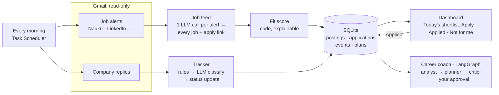

# Job Search Copilot

[](https://github.com/vinaychand22/job-search-copilot/actions/workflows/ci.yml)

An AI copilot that runs every morning on its own: it reads my **job-alert emails** from Naukri and LinkedIn,
ranks every job against my profile and gives me **today's shortlist with apply links**; it reads **company
replies** and keeps each application's status up to date; and it **diagnoses where my applications stall**
and plans the next week.

Python · LangGraph · SQLite · Streamlit · model-agnostic (OpenAI, Azure OpenAI, Gemini, local Ollama, or Claude).

## Why I built this

I've been job hunting for six months across Naukri, LinkedIn, Talent500 and company sites. I tracked
applications by moving resume files between folders (`active/`, `applied/`, `rejected/`, `not applied/`),
and checked my inbox by hand to work out where each application stood. Three things took the most time:

1. **Finding the relevant jobs** among everything the portals send.
2. **Following emails from companies** I'd applied to, with recruiter replies and assessment links mixed in with job alerts.
3. **Knowing each application's status** without opening every folder and every thread.

So I built the tool I needed, and I measure it on my own search (see [Impact](#impact)).

## What it does



| Component | Problem it removes | How it works |
|---|---|---|
| **Job feed** | Reading every alert and posting to find the few that fit | Alert emails are read automatically. Code extracts and numbers the job links; **one model call per alert** lists every job (title, company, location, experience, salary, skills, domain) and points to a link number, so the model never types a URL. Code parses salary/experience, removes duplicates across portals, and scores each job. |
| **Fit score** | "Is this job for me?" | A transparent formula: skills 35, role 20, experience 15, location 15, domain 10, nice-to-have 5, plus hard filters (dealbreaker titles, minimum salary). Every score comes with reasons and missing skills. |
| **Today's shortlist** | Deciding where to apply | Jobs above your minimum score, best first, with **Open & apply**, **Applied** (starts tracking the application) and **Not for me** (never shown again). |
| **Application tracker** | Working out each application's status from email | Rules handle alerts and OTPs for free; the model classifies the rest (applied, assessment, interview, rejection, offer, recruiter), extracts company, role and deadline, and moves the application forward. |
| **Career coach** (multi-agent, LangGraph) | Not knowing *why* applications fail | An **analyst agent** queries your own data through tools and must cite numbers that came from those tools, or its diagnosis is rejected. A **planner** writes next week's plan, a **code critic** checks it, and the graph **pauses for your approval**. |
| **Daily run** | Remembering to do all of the above | `python -m copilot.daily`, scheduled every morning, within a fixed request budget; logs every run to `data/runs.csv`. |

## Impact

Measured on my own search. Every number here comes from a script; nothing is estimated.

| What | Before (manual) | With copilot | How it's measured |
|---|---|---|---|
| Time to go through job alerts each day | _fill_ | _fill_ | `python -m copilot.impact log alerts <min> --mode manual/copilot` |
| Jobs read automatically per day | — | _fill_ | `data/runs.csv` (`jobs_found`) |
| Alert reading accuracy (jobs found, right link) | — | _fill_ | `python -m copilot.feed.eval --data my_alerts.jsonl` |
| Daily tracking time | _fill from impact log_ | _fill_ | `python -m copilot.impact report` (median minutes, n ≥ 5 each) |
| Time to triage postings | _fill_ | _fill_ | same, task `finding_jobs` |
| Email classification accuracy | — | _fill_ | `python -m copilot.tracker.eval --data my_labelled_emails.jsonl` |
| Share of emails handled without an LLM call | — | _fill_ | `rule_coverage` in the tracker eval |
| Ranking precision@5 | — | _fill_ | `python -m copilot.matcher.eval` on postings I labelled |
| Coach diagnosis accuracy | — | _fill_ | `python -m copilot.coach.eval` (synthetic searches with planted bottlenecks) |

Sanity check, offline: on the 12 bundled synthetic postings, the scoring rule ranks all 5 relevant
postings first (precision@5 = 1.0, `make eval-matcher-offline`). I wrote those labels alongside the rule,
so it only proves the rule behaves as designed. The real number comes from postings I label myself.

## Quick start

Requires Python 3.11+ and Git. The `.env` file is loaded automatically.

**Windows (Command Prompt)**: one line at a time
```
git clone https://github.com/vinaychand22/job-search-copilot.git
cd job-search-copilot
py -m venv .venv
.venv\Scripts\activate
pip install -r requirements.txt
python -m pytest -q
set COPILOT_DEMO=1
python -m streamlit run app.py
```
The tests run offline with no API key; `COPILOT_DEMO=1` shows the dashboard with sample data
(close the window, or run `set COPILOT_DEMO=`, to switch back to your own data).

**macOS / Linux**
```bash
git clone https://github.com/vinaychand22/job-search-copilot.git && cd job-search-copilot
python3 -m venv .venv && source .venv/bin/activate
pip install -r requirements.txt
make test && COPILOT_DEMO=1 streamlit run app.py
```

### Use it for real
1. **AI model:** `copy .env.example .env`, add a key (free options in [docs/SETUP.md](docs/SETUP.md)), check with `python -m core.check`.
2. **Your profile:** `copy config\profile.example.toml config\profile.toml` and edit skills, domains, roles, cities, minimum score.
3. **Gmail + job alerts + morning schedule:** follow [docs/DEPLOY.md](docs/DEPLOY.md).
4. Every day: open the dashboard (`python -m streamlit run app.py`) → **Today's shortlist**.

Other commands: `python -m copilot.daily --demo` (sample alerts, no Gmail) ·
`python -m copilot.folders "<Resumes folder>"` (import old folders) ·
`python -m copilot.coach.run --hours 8` (weekly plan) · `python -m copilot.matcher.run --report` (rescore, free).

### Label your own data (for real accuracy numbers)
Save real alert or reply emails in `my_alerts.jsonl` / `my_labelled_emails.jsonl` (keep them outside git),
in the format of `copilot/feed/data/alerts_golden.jsonl` and `copilot/tracker/data/emails_golden.jsonl`,
then run the evals with `--data`.

## Design decisions

- **Bring the jobs to the user.** Jobs come from alert emails the user already receives, not from scraping job sites (against their terms, and blocked) or manual pasting.
- **One model call per alert, not per job.** A 15-job alert costs one request, which keeps a free tier (about 20 requests/day) workable. A per-run request budget stops cleanly and leaves the rest for the next run.
- **The model never writes URLs.** Code extracts and numbers the links; the model answers "job 3 is link #7", and a wrong number falls back to matching the link text against the job title.
- **Deployed in two places on purpose.** The real copilot runs on the user's laptop (personal email never leaves it); a public demo with sample data runs on Streamlit Community Cloud.

- **Model-agnostic.** One internal message format, with small adapters for OpenAI-compatible APIs (OpenAI, Azure, Gemini, Ollama) and Anthropic. Switching vendors is a `.env` change, and comparing them is an eval run.
- **Workflows where possible, agents where needed.** Tracker and matcher are fixed pipelines. Only the coach's analyst is an autonomous tool-using agent, because what it needs to look up depends on what it finds.
- **Agents must show evidence.** The analyst's diagnosis is rejected unless every number in it appeared in a tool result during that run.
- **Human in the loop.** The coach's LangGraph workflow pauses (`interrupt`) for approval or feedback; nothing is saved until you approve.
- **Know when not to answer.** With fewer than 10 tracked applications the coach skips analysis entirely (zero analyst calls) and says the data is too thin.
- **Rules before the model.** Job alerts, newsletters and OTPs are recognised from sender and subject at zero cost. The model only sees emails that need judgment.
- **The model reads; code decides.** The LLM extracts fields into a validated schema. Status transitions, fit scores and funnel metrics are plain code you can test and explain.
- **Validation with one repair round.** If the model returns an invalid date or breaks a business rule (`salary_min > salary_max`), the exact error is sent back once for a fix.
- **Status only moves forward.** A late "thanks for applying" email can't overwrite an interview or a rejection.
- **Idempotent and incremental.** Processed email IDs and posting hashes are stored, so re-running costs zero tokens.
- **Untrusted input.** Emails and postings are treated as data. The model has no tools to misuse, so an injected instruction can at worst cause a wrong label, which the eval catches.

## Privacy
Everything stays on your machine: one SQLite file in `data/`. Your profile, Gmail credentials and token are gitignored.
Email text is sent to the model API only when needed: replies the rules can't classify (first 3,000 characters)
and job-alert emails (job listings only, up to 20,000 characters).
To keep email fully private, run the tracker with a local model (`LLM_PROVIDER=ollama`).

## Roadmap
- [x] Application tracker (Gmail) with eval
- [x] Job matcher + market report with eval
- [x] Dashboard and impact logging
- [x] Model-agnostic LLM layer (OpenAI, Azure, Gemini, Ollama, Claude)
- [x] Career coach: LangGraph multi-agent workflow with evidence checks and human approval
- [x] Job feed from alert emails, daily shortlist with apply links, domain matching
- [x] Deployment: morning schedule on Windows, public demo on Streamlit Community Cloud
- [ ] Semantic job matching: embeddings plus hybrid ranking against your resume
- [ ] MCP server: query your tracker from Claude Desktop, Cursor or ChatGPT
- [ ] Production: FastAPI, Postgres, cloud worker, Docker, Langfuse tracing, CI with eval gates
- [ ] Analytics copilot: natural language to SQL on a public retail dataset, with an execution-accuracy eval

## License
MIT. See [LICENSE](LICENSE).

## Repo layout
```
app.py                    Streamlit dashboard
copilot/db.py             SQLite schema and status rules (shared memory)
copilot/daily.py          the morning run: alerts -> jobs, replies -> statuses, shortlist, run log
copilot/feed/             job-alert reader, shortlist and decisions, eval
copilot/tracker/          Gmail source, classifier, sync pipeline, eval
copilot/matcher/          extractor, scoring, market report, eval
copilot/coach/            LangGraph coach: tools, schemas, graph, scenarios, eval
copilot/analytics.py      funnel metrics (by portal, by role family)
copilot/folders.py        one-time import of resume folders
copilot/impact.py         before/after time logging
core/                     model-agnostic LLM layer, agent loop, structured output + repair, eval harness
docs/SETUP.md             how to get an API key (free options included)
docs/DEPLOY.md            Gmail, job alerts, morning schedule, public demo
scripts/run_daily.bat     what Windows Task Scheduler runs
tests/                    offline tests with a scripted fake LLM
```
See [LEARN.md](LEARN.md) for a guided walkthrough of how every part works.
