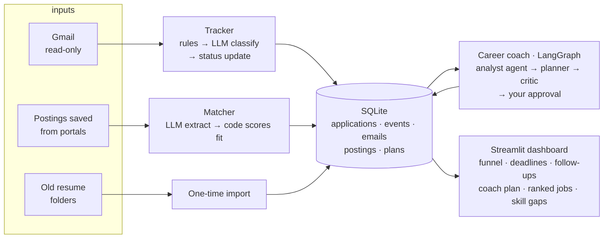

# Job Search Copilot

[](https://github.com/vinaychand22/job-search-copilot/actions/workflows/ci.yml)

An AI copilot for the parts of a job search that waste the most time: **finding relevant jobs** in a flood
of postings, **keeping track of every application** across Naukri, LinkedIn, Talent500 and company sites,
and **working out why applications stall** and what to do next week.

Python · LangGraph · SQLite · Streamlit · model-agnostic (OpenAI, Azure OpenAI, Gemini, local Ollama, or Claude).

## Why I built this

I've been job hunting for six months across Naukri, LinkedIn, Talent500 and company sites. I tracked
applications by moving resume files between folders (`active/`, `applied/`, `rejected/`, `not applied/`),
and checked my inbox by hand to work out where each application stood. Three things took the most time:

1. **Finding the relevant jobs** among everything the portals send.
2. **Following emails from companies** I'd applied to, with recruiter replies and assessment links mixed in with job alerts.
3. **Knowing each application's status** without opening every folder and every thread.

So I built the tool I needed, and I measure it on my own search (see [Impact](#impact)).

## What it does



| Component | Problem it removes | How it works |
|---|---|---|
| **Application tracker** | Manually working out each application's status from email | Reads job-search emails (read-only). Rules handle alerts and OTPs for free; the model classifies the rest (applied, assessment, interview, rejection, offer, recruiter), extracts company, role and deadline, and advances the application. Never processes an email twice. |
| **Job matcher** | Reading dozens of irrelevant postings | The model turns a pasted posting into structured fields; a transparent scoring rule (skills 45, role 20, experience 15, location 15, nice-to-have 5, plus hard filters) ranks them and lists the skills you're missing. |
| **Career coach** (multi-agent, LangGraph) | Not knowing *why* applications fail | An **analyst agent** queries your own data through tools (funnel by portal and role family, read-only SQL, skill gaps) and must cite numbers that actually came from those tools, or its diagnosis is rejected. A **planner** turns the diagnosis into next week's plan. A **code critic** checks the hour budget, that the plan targets the bottleneck, and that it doesn't double down on your worst segment. The graph then **pauses for your approval** before anything is saved. |
| **Market report** | Guessing what to learn next | Aggregates skill demand across every posting you've collected and lists the top gaps. |
| **Dashboard** | No single view of the search | Funnel and conversion by portal, upcoming deadlines, follow-ups due, ranked matches, skill demand, impact log. |

## Impact

Measured on my own search. Every number here comes from a script; nothing is estimated.

| What | Before (manual) | With copilot | How it's measured |
|---|---|---|---|
| Daily tracking time | _fill from impact log_ | _fill_ | `python -m copilot.impact report` (median minutes, n ≥ 5 each) |
| Time to triage postings | _fill_ | _fill_ | same, task `finding_jobs` |
| Email classification accuracy | — | _fill_ | `python -m copilot.tracker.eval --data my_labelled_emails.jsonl` |
| Share of emails handled without an LLM call | — | _fill_ | `rule_coverage` in the tracker eval |
| Ranking precision@5 | — | _fill_ | `python -m copilot.matcher.eval` on postings I labelled |
| Coach diagnosis accuracy | — | _fill_ | `python -m copilot.coach.eval` (synthetic searches with planted bottlenecks) |

Sanity check, offline: on the 12 bundled synthetic postings, the scoring rule ranks all 5 relevant
postings first (precision@5 = 1.0, `make eval-matcher-offline`). I wrote those labels alongside the rule,
so it only proves the rule behaves as designed. The real number comes from postings I label myself.

## Quick start

Requires Python 3.11 or newer and Git. Your `.env` file is loaded automatically.

**Windows (PowerShell)**
```powershell
git clone https://github.com/vinaychand22/job-search-copilot.git; cd job-search-copilot
py -m venv .venv
.venv\Scripts\Activate.ps1
pip install -r requirements.txt
python -m pytest -q          # 34 offline tests, no API key needed
python -m copilot.demo       # builds a demo database
$env:COPILOT_DB="data\demo.db"; streamlit run app.py
```

**macOS / Linux**
```bash
git clone https://github.com/vinaychand22/job-search-copilot.git && cd job-search-copilot
python3 -m venv .venv && source .venv/bin/activate
pip install -r requirements.txt
make test && make demo
```

### Use it for real

```bash
# copy the templates (Windows: use "copy" instead of "cp")
cp config/profile.example.toml config/profile.toml   # edit: your skills, target roles, cities, minimum salary
cp .env.example .env                                  # choose a model provider: see docs/SETUP.md (free options exist)

python -m copilot.folders "<path to your Resumes folder>" --dry-run   # preview the import of your old folders
python -m copilot.folders "<path to your Resumes folder>"             # import them

python -m copilot.tracker.run --max 100     # first Gmail sync (opens a browser once for consent)
python -m copilot.matcher.run inbox/postings
python -m copilot.coach.run --hours 8 --goal "Data analyst role in Hyderabad or remote"
streamlit run app.py
```

### Gmail setup (one time, about 10 minutes)

1. Go to [Google Cloud Console](https://console.cloud.google.com/), create a project, and enable the **Gmail API**.
2. Under **OAuth consent screen**, choose *External* and add your own Gmail address as a **test user**.
3. Under **Credentials → Create credentials → OAuth client ID**, choose **Desktop app**, then download the JSON.
4. Save it as `config/credentials.json` (gitignored). The first sync opens a browser for consent and saves `config/token.json`.

The app requests only the `gmail.readonly` scope, so it cannot send, delete or change mail.

### Label your own emails (for a real accuracy number)
Add lines like this to `my_labelled_emails.jsonl` (keep it outside git):
```json
{"message_id":"x1","sender":"...","subject":"...","received_at":"2026-10-01T10:00:00","body":"...","expected":{"category":"assessment","company":"Acme","action_required":true,"deadline":"2026-10-03"}}
```

## Design decisions

- **Model-agnostic.** One internal message format, with small adapters for OpenAI-compatible APIs (OpenAI, Azure, Gemini, Ollama) and Anthropic. Switching vendors is a `.env` change, and comparing them is an eval run.
- **Workflows where possible, agents where needed.** Tracker and matcher are fixed pipelines. Only the coach's analyst is an autonomous tool-using agent, because what it needs to look up depends on what it finds.
- **Agents must show evidence.** The analyst's diagnosis is rejected unless every number in it appeared in a tool result during that run.
- **Human in the loop.** The coach's LangGraph workflow pauses (`interrupt`) for approval or feedback; nothing is saved until you approve.
- **Know when not to answer.** With fewer than 10 tracked applications the coach skips analysis entirely (zero analyst calls) and says the data is too thin.
- **Rules before the model.** Job alerts, newsletters and OTPs are recognised from sender and subject at zero cost. The model only sees emails that need judgment.
- **The model reads; code decides.** The LLM extracts fields into a validated schema. Status transitions, fit scores and funnel metrics are plain code you can test and explain.
- **Validation with one repair round.** If the model returns an invalid date or breaks a business rule (`salary_min > salary_max`), the exact error is sent back once for a fix.
- **Status only moves forward.** A late "thanks for applying" email can't overwrite an interview or a rejection.
- **Idempotent and incremental.** Processed email IDs and posting hashes are stored, so re-running costs zero tokens.
- **Untrusted input.** Emails and postings are treated as data. The model has no tools to misuse, so an injected instruction can at worst cause a wrong label, which the eval catches.

## Privacy
Everything stays on your machine: one SQLite file in `data/`. Your profile, Gmail credentials and token are gitignored.
Email text is sent to the model API only for emails the rules can't classify, and only the first 3,000 characters.
To keep email fully private, run the tracker with a local model (`LLM_PROVIDER=ollama`).

## Roadmap
- [x] Application tracker (Gmail) with eval
- [x] Job matcher + market report with eval
- [x] Dashboard and impact logging
- [x] Model-agnostic LLM layer (OpenAI, Azure, Gemini, Ollama, Claude)
- [x] Career coach: LangGraph multi-agent workflow with evidence checks and human approval
- [ ] Semantic job matching: embeddings plus hybrid ranking against your resume
- [ ] MCP server: query your tracker from Claude Desktop, Cursor or ChatGPT
- [ ] Production: FastAPI, Postgres, scheduled sync worker, Docker, Langfuse tracing, CI with eval gates, live demo
- [ ] Analytics copilot: natural language to SQL on a public retail dataset, with an execution-accuracy eval

## License
MIT. See [LICENSE](LICENSE).

## Repo layout
```
app.py                    Streamlit dashboard
copilot/db.py             SQLite schema and status rules (shared memory)
copilot/tracker/          Gmail source, classifier, sync pipeline, eval
copilot/matcher/          extractor, scoring, market report, eval
copilot/coach/            LangGraph coach: tools, schemas, graph, scenarios, eval
copilot/analytics.py      funnel metrics (by portal, by role family)
copilot/folders.py        one-time import of resume folders
copilot/impact.py         before/after time logging
core/                     model-agnostic LLM layer, agent loop, structured output + repair, eval harness
docs/SETUP.md             how to get an API key (free options included)
tests/                    offline tests with a scripted fake LLM
```
See [LEARN.md](LEARN.md) for a guided walkthrough of how every part works.
