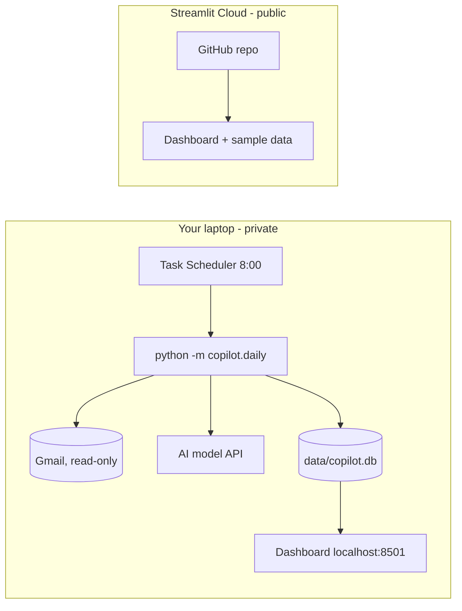

# Deployment

"Deploying" means running the code somewhere it works without you starting it by hand.
This project is deployed in two places, on purpose:

| Where | What runs there | Why there |
|---|---|---|
| **Your laptop**, every morning (Windows Task Scheduler) | The real copilot: reads your Gmail, finds jobs, updates applications | Your emails and Gmail login never leave your machine |
| **Streamlit Community Cloud** (free) | The dashboard with **sample data only** (`COPILOT_DEMO=1`) | A public link for your resume, with zero personal data |



---

## 1. Gmail (one time, about 15 minutes)

1. Open **https://console.cloud.google.com** with your Gmail account. Use the project you created for the
   AI key, or create one (top bar → project picker → **New project**).
2. Left menu → **APIs & Services → Library** → search **Gmail API** → **Enable**.
3. **APIs & Services → OAuth consent screen** (may be called **Google Auth Platform**):
   - User type **External**, app name `Job Search Copilot`, your email for support and contact.
   - **Audience / Test users** → add your own Gmail address.
4. **APIs & Services → Credentials → Create credentials → OAuth client ID** → type **Desktop app** →
   **Create** → **Download JSON**.
5. Rename the downloaded file to `credentials.json` and move it to `job-search-copilot\config\`.
6. Run once in Command Prompt (venv active):
   ```
   python -m copilot.daily --max-emails 20
   ```
   A browser opens: choose your account → you may see **"Google hasn't verified this app"** → **Continue**
   (it's your own app) → allow **read** access. The login is saved in `config\token.json` (never uploaded).

**Avoid weekly re-login:** apps in "Testing" mode get a login that expires after 7 days. Go back to the
OAuth consent screen and click **Publish app** (status "In production"). For a personal app you don't need
Google's review: you'll keep seeing the "unverified" warning when signing in, but the login stops expiring.
If it ever expires anyway, the next run simply opens the browser to sign in again.

## 2. Job alerts (one time, 10 minutes)

The copilot reads job-alert emails, so make sure you get them:
- **Naukri:** Jobs → *Create job alert* for each target role + city (e.g. "Data Analyst, Hyderabad").
- **LinkedIn:** search a role → turn on the **Set alert** toggle above the results → frequency *Daily*,
  notify by *Email*.
- Optional: Instahyre, Cutshort, Hirist, Foundit and Indeed alerts are recognised too.

Senders read: see `DEFAULT_ALERTS_QUERY` in `copilot/config.py`; override with `alerts_query` in your profile.

## 3. Run it every morning (Windows, 5 minutes)

`scripts\run_daily.bat` runs the daily job and appends its output to `data\daily.log`.
Create the schedule in Command Prompt (adjust the path if your folder is elsewhere):

```
schtasks /Create /F /SC DAILY /ST 08:00 /TN "JobSearchCopilot" /TR "\"%USERPROFILE%\Documents\job-search-copilot\scripts\run_daily.bat\""
schtasks /Create /F /SC ONLOGON /TN "JobSearchCopilot-OnLogon" /TR "\"%USERPROFILE%\Documents\job-search-copilot\scripts\run_daily.bat\""
```
- The first runs at 8:00 if the laptop is on; the second runs whenever you log in, covering days the
  laptop was off at 8. Running twice is harmless: already-read emails are skipped at zero cost.
- Test it now: `schtasks /Run /TN "JobSearchCopilot"` then open `data\daily.log`.
- Remove: `schtasks /Delete /TN "JobSearchCopilot" /F`.

If `schtasks` is blocked on a managed laptop, run `scripts\run_daily.bat` by double-clicking it each morning.

**Request budget:** each run uses at most `LLM_DAILY_BUDGET` model requests (default 18, under the
20/day free tier). Emails left over are read on the next run. Raise it in `.env` if you switch to a paid key.

## 4. Public demo on Streamlit Community Cloud (free, 10 minutes)

1. Go to **https://share.streamlit.io** → **Sign in with GitHub** (account `vinaychand22`).
2. **Create app** → **Deploy a public app from GitHub**:
   - Repository `vinaychand22/job-search-copilot`, branch `main`, main file `app.py`.
   - Choose an app URL, e.g. `vinay-job-copilot`.
3. **Advanced settings**: Python **3.12**; in **Secrets** paste:
   ```toml
   COPILOT_DEMO = "1"
   ```
   (Top-level secrets are exposed to the app as environment variables; this switches on demo mode.)
4. **Deploy**. Every `git push` to `main` redeploys automatically.

Put the resulting link (`https://<name>.streamlit.app`) in the repo's **About** box and on your resume.
The demo never has an API key or Gmail access; never add `.env` values to its secrets.

## 5. What to check when something breaks

| Symptom | Check |
|---|---|
| No new jobs | `data\daily.log`; are alert emails arriving in Gmail? `python -m core.check` |
| `429` / quota | Free-tier limit: wait for reset (~1 PM IST), lower `--budget`, or use another model |
| Browser opens every morning | Publish the OAuth app (section 1) |
| Demo shows an error | Streamlit Cloud → app → **Manage app** → logs |
| Scores feel wrong | Edit `config/profile.toml`; rescore free with `python -m copilot.matcher.run --report` |
